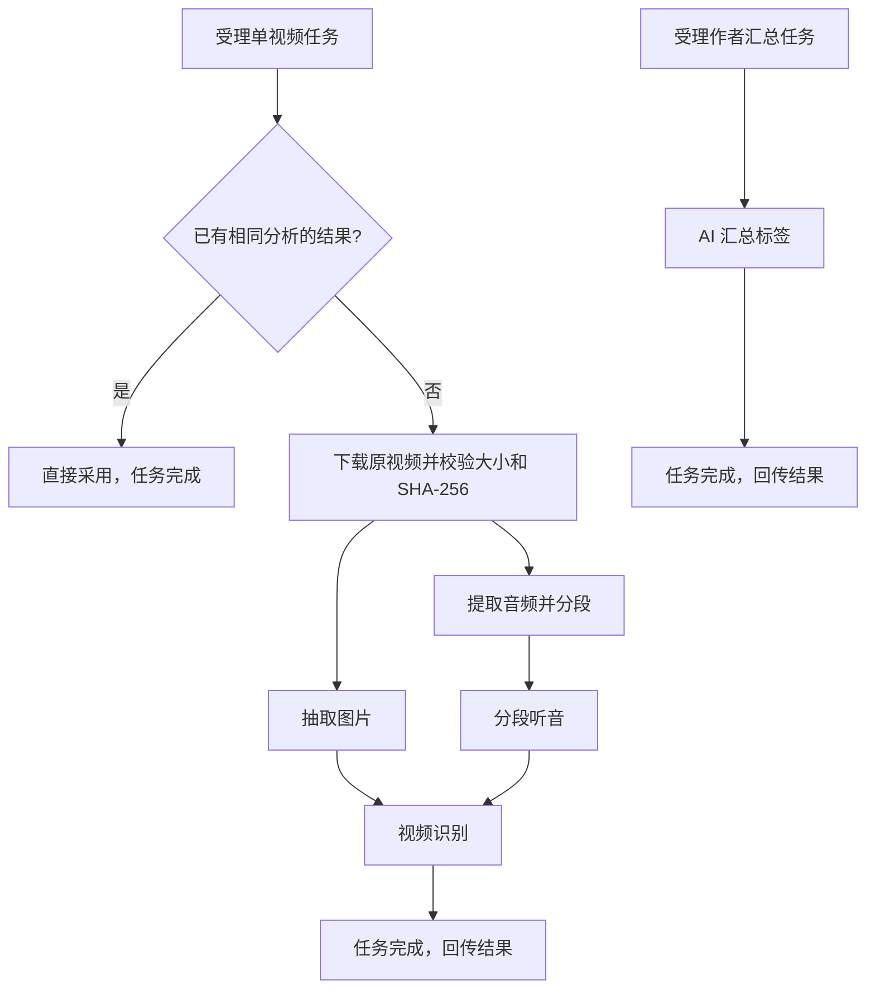

# 视频分析服务设计

运行和部署方式见 [README](../README.md)。配套项目见[调度中心](https://github.com/sunluojia/video-scheduler-center)。

## 1. 负责什么

只负责分析执行：接收调度中心发来的单视频分析任务和作者汇总任务，下载并校验原视频，抽帧、提音、听音、识别、汇总，保存执行状态，并按阶段把状态和结果回传调度中心。

不提供页面，只提供 API。批次和作者只是任务上的标签，用于成组暂停、轮流派发和排查。作者收齐了哪些作品、哪些视频失败、整批何时结束，以及无作品、只有图文、私密账号等不需要模型的结论，都由调度中心判断。

## 2. 分析流程



**单视频分两步调用 AI：**

1. **听音：** 判断口播、音乐等声音内容，提取讲话文本。只有无音轨或数字静音（采样全零）时跳过；低音量的讲话和音乐、测不出音量的音频照常听音。长音频分段处理，单视频同时听音的段数受限，按时间顺序合并结果。
2. **视频识别：** 把图片、听音结果、讲话文本、发布描述和话题一起交给模型，输出视频标签、商品、摘要及话题翻译。商品保留品类、品牌、原始品名和明确对应的尺码，每项判断附带所在图片序号、讲话原文和依据说明，供人工核对；尺码标签带上商品名，例如“卫衣大号”。

识别标签与发布话题分开保存，避免把话题当成画面事实。视频时长不作为标签，识别和汇总结果里都不出现；模型给出的时长标签由程序丢掉。暂不接独立 ASR，由听音直接输出讲话文本。

**作者汇总也使用 AI。** 输入由调度中心随任务提供，是参与汇总的各视频识别结果；输出语义去重后的作者标签。覆盖范围和失败说明由调度中心按作品清单给出。

## 3. 与调度中心的约定

两个服务通过同一个 Redis 上的 Dramatiq 队列传任务和事件，通过 HTTP 调用对方的接口。两边需要一致的：Redis 地址和命名空间（默认 `dramatiq`）、队列名和处理器名、消息结构、Dramatiq 版本（2.x）、服务凭据。

### 3.1 任务：调度中心 → 分析服务

队列 `analysis.tasks`。每条消息只有一个参数：一个 JSON 对象。

| 处理器 | 用途 |
| --- | --- |
| `analyze_video` | 单视频分析 |
| `summarize_creator` | 作者汇总 |

`analyze_video`：

```json
{
  "job_id": "v-20261117-0001",
  "run": 1,
  "batch_id": "20261117-01",
  "creator_id": "c-123",
  "material": {"id": "m-1", "size": 10485760, "sha256": "64 位小写十六进制"},
  "description": "发布描述",
  "topics": ["#makeup"],
  "allow_reuse": true
}
```

`summarize_creator`：

```json
{
  "job_id": "s-c-123-1",
  "run": 1,
  "batch_id": "20261117-01",
  "creator_id": "c-123",
  "videos": [{"job_id": "v-20261117-0001", "run": 1, "recognition": {"tags": ["美妆"], "summary": "…"}}]
}
```

- `job_id` 是调度中心的任务 ID，分析服务以它为准：查询、控制和回传都用它。
- 相同或更小轮次的重复投递直接忽略，不重复受理，也不再回传；已取消批次的任务同样忽略。
- 更大的轮次表示重新分析：丢弃上一轮的进度和结果，从头开始；上一轮迟到的结果不会保存。重新分析时调度中心传 `allow_reuse: false`。
- 格式错误的消息不重试，直接进入死信队列；数据库暂时不可用等其他错误，按 Dramatiq 的退避策略重试。

### 3.2 事件：分析服务 → 调度中心

队列 `analysis.events`，处理器 `analysis_event`，参数是一个事件对象。事件与业务数据在同一事务写入发件箱，再由 Worker 投递；写入 Redis 成功后才标记已发布，至少投递一次。消息 ID 即 `event_id`，调度中心按它去重；同一任务的事件按 `run` 和 `occurred_at` 排序。

**任务事件** `type: "job"`：受理、完成、失败、待核查。

| 字段 | 说明 |
| --- | --- |
| `event_id`、`job_id`、`run`、`kind`（video／summary）、`status`、`occurred_at` | 身份与状态 |
| `result` | 完成时的结果。单视频为 `{"listening": 合并的听音结果, "recognition": 识别结果}`；汇总为 `{"tags": [...], "videos": [{"job_id", "run"}]}` |
| `error` | 失败或待核查的原因 |
| `reused_from` | 采用了哪个任务的结果 |
| `artifacts_until` | 抽帧图片和音频段可以获取到此时 |

**阶段事件** `type: "stage"`：每个阶段开始、完成、等待重试、失败、待核查或跳过。

| 字段 | 说明 |
| --- | --- |
| `event_id`、`job_id`、`run`、`stage`、`segment`（听音段号）、`attempt`、`status`、`occurred_at` | 身份与状态 |
| `model`、`prompt_version` | AI 阶段实际使用的模型和提示词版本；`prompt_version` 为空表示内置提示词 |
| `result` | 完成时该阶段的结果，见下表；跳过时为 `{"skip_reason": 原因}` |
| `error`、`retry_at` | 失败原因；等待重试时的下次执行时间 |

| 阶段 `stage` | 完成时的 `result` |
| --- | --- |
| `fetch` | `size`、`sha256`、`duration`、`has_audio`；采用已有结果时为 `{"reused_from": 任务 ID}` |
| `extract_frames` | `frame_count`，`frames: [{index, at, url}]`；`at` 是采样时间（秒），约为 第 k 张 × 时长 ÷ 张数 |
| `extract_audio` | `segment_count`，`segments: [{index, start, end, url}]`；数字静音时 0 段并带 `skip_reason`。没有音轨时不执行这个阶段，回传一条跳过事件 |
| `listen` | 该段的声音分类和讲话文本 |
| `recognize` | 完整识别结果：标签、商品（含尺码及依据）、摘要、话题翻译 |
| `summarize` | `tags` |

`url` 是本服务接口上的路径，调度中心加上注册时上报的地址、带服务凭据获取。

“待核查”表示模型请求已经发出、但没有拿到明确结果（超时或 Worker 中断）。分析服务不自行重发，由调度中心下达补跑。

### 3.3 本服务的 HTTP 接口

全部接口在 `/api` 下，要求 `Authorization: Bearer <服务凭据>`。接口文档 `/docs` 不含数据，保持开放，便于开发和排查。

| 接口 | 用途 |
| --- | --- |
| `GET /api/jobs/{job_id}` | 任务、当前轮次的各阶段及结果、模型调用记录（含之前轮次），用于排查和对账 |
| `GET /api/jobs/{job_id}/frames/{index}`、`/audio/{index}` | 保留期内获取抽帧图片和音频段 |
| `POST /api/jobs/{job_id}/retry`、`/cancel` | 补跑、取消，返回任务的实际状态；`occurred_at` 是取得这个状态的时间，与事件同一时钟，调度中心据此与事件比较先后 |
| `POST /api/batches/{batch_id}/pause`、`/resume` | 暂停、继续该批次；可以先于任务到达 |
| `POST /api/batches/{batch_id}/retry`、`/cancel` | 成批补跑、取消，返回受影响任务的状态 |
| `GET /api/status` | 各状态任务数、各阶段等待和执行中的数量、各模型额度占用、剩余磁盘 |
| `/api/ai/providers`、`/api/ai/models`、`/api/ai/routes`、`/api/ai/prompts/{kind}` | AI 供应商、模型、任务路由和系统提示词，由调度中心的页面经后端转发使用 |
| `GET /api/ai/usage?since=&until=&bucket=hour|day&batch_id=` | 一段时间里的模型调用，按北京时间的整点或零点、环节和模型汇总：调用次数、成功、失败、输入和输出 token、命中缓存的 token、报告了命中数的调用的输入 token、调用总耗时（秒） |

- **暂停：** 该批次的任务不再开始新的阶段；在途的模型请求照常完成并保存。
- **补跑：** 只重做失败和待核查的阶段，已完成的阶段不重跑。补跑需要的视频和中间文件只保留到保留期结束，过期后请用新轮次重新分析。
- **取消：** 不再推进，删除未完成的阶段，在途请求的结果丢弃，派生文件随即清理；模型调用记录保留。已完成的任务不受影响。批次取消后记下标记，之后到达的该批次任务（包括取消前已进入队列的）不再受理；批次可以先于任务被取消。

### 3.4 本服务调用调度中心

| 接口 | 用途 |
| --- | --- |
| `PUT /api/analysis-services/{instance_id}`，内容 `{"url", "version"}` | 注册兼心跳，默认每 15 秒一次；调度中心可以晚于本服务启动 |
| `DELETE /api/analysis-services/{instance_id}` | 正常停止时注销 |
| `GET /api/materials/{material_id}` | 下载原视频；支持 `Range` 时断点续传（返回 206 续写，返回 200 整份重写） |

## 4. 执行与利用率

目标是：**只要有可做的工作，模型额度就保持用满；素材按需提前备好，模型不等素材，磁盘上也不堆积素材。**

### 4.1 按阶段调度

调度单位是一项具体工作，例如下载、抽帧、一个音频段的听音、识别。只有前置条件满足、执行时间已到、批次未暂停且资源额度可用，才领取执行；完成一项就推进后继阶段并立即寻找下一项。等待前置结果、额度或重试时间的任务只是留在数据库里，不占用协程、线程或连接。

批次之间轮流派发，最久没有派发过的批次优先；同一批次按到达先后。

| 工作 | 执行方式 | 并发限制 |
| --- | --- | --- |
| 下载 | HTTPX 流式下载，异步写文件 | 每个 Worker 的下载名额，不占 FFmpeg 名额 |
| 抽帧、提音与分段 | FFmpeg／FFprobe 子进程，同一视频的抽帧和提音并行 | 每个 Worker 的 FFmpeg 名额 |
| 听音、识别、汇总 | LangChain 原生异步调用 | 各模型的全局在途额度和每分钟请求数 |
| 数据库读写 | SQLAlchemy 异步接口，短事务，不持有事务等待模型 | 连接池 |

### 4.2 AI 额度分配

额度按模型计算，多个 Worker 共用同一套计数。听音、识别、汇总按“目标份额＋空闲借用”分配：份额未用满且有任务的类型优先；都已用满时，剩余额度借给等待中的类型；等待越久优先级越高。已发出的请求不中断，后到的类型通过后续释放的额度拿回份额。

每次请求在领取时确定模型、提示词和超时，并计入该模型的额度直到结束；切换路由只影响之后领取的请求。

### 4.3 按需备料

开始一个新视频（领取下载）前判断：

- **等待模型的工作**低于各模型并发额度之和的 `VA_ADMISSION_FACTOR` 倍（默认 2）。等待模型的工作 = 可以执行的 AI 任务数 ＋ 正在下载和抽取、尚未产生 AI 任务的视频数。
- 处理中视频数低于 `VA_MEDIA_BACKLOG`、工作目录所在磁盘剩余不少于 `VA_MIN_FREE_DISK_GB`。这两项只用来保护磁盘，正常情况下不会触发。

多个 Worker 的判断在数据库咨询锁内依次进行，合计不会越过上限。模型额度调整、某个模型暂时不可用时，备料速度自动跟着变。没有配置任何模型路由时不开始新视频。

### 4.4 不做重复和无用的工作

- **复用结果：** 素材 SHA-256、发布描述和话题、抽帧张数和音频分段时长、听音和识别所用模型配置（供应商、模型、接口地址、参数）和提示词内容都相同，且已有完成的结果时，直接采用，不下载也不调用模型。分析期间切换了模型或提示词的结果不作为复用来源。调度中心可以用 `allow_reuse: false` 关闭。
- 无音轨或数字静音时不听音；图片高度缩到 720 像素以内。
- 失败后只重做失败的阶段。

### 4.5 失败、超时与租约

| 情况 | 处理方式 |
| --- | --- |
| 下载、媒体处理或模型返回错误 | 按退避时间重试，次数用尽后任务失败 |
| 模型请求超时，或 Worker 在等待响应时中断 | 转待核查，不自动重发 |
| 下载的视频大小或 SHA-256 不一致 | 删除后按失败重试，下次从头下载 |
| 本机没有 FFmpeg／FFprobe | Worker 启动时告警；媒体阶段按失败处理，错误写明需要安装 FFmpeg |

任务每次被领取都生成新的租约标识，只有仍持有该租约的执行才能保存结果；任务被回收、补跑、取消或重新分析后，迟到的旧执行结果直接丢弃。租约到期仍未结束的任务由其他 Worker 回收。

### 4.6 文件保留

每个任务在工作目录下有一个子目录。下载的视频在识别完成后删除；抽帧图片和音频段在任务结束（完成、失败或待核查）后保留 `VA_ARTIFACT_RETENTION_HOURS` 小时（默认 72），期间可以通过接口获取，到期由 Worker 清理。取消的任务立即清理。

## 5. 模块怎么分

公共基础放在 `core`，业务按“业务域／模块”两级组织，模块内按 `models` 业务模型与规则、`tables` 表结构与映射、`repository` 数据读写、`service` 业务操作、`schemas` 接口结构、`router` 接口分文件。业务模型是普通数据类，不依赖 ORM；素材下载、媒体处理和大模型通过 `scheduling/execution/ports.py` 中的接口使用，具体实现在 `integrations`。

| 业务域 | 模块 | 职责 |
| --- | --- | --- |
| analysis 分析任务 | job、batch、upstream | 任务的状态、结果和复用；批次暂停；受理任务并生成回传事件 |
| scheduling 调度执行 | task、execution、status | 阶段任务的状态、退避、补跑和取消；按阶段领取并执行、按需备料；运行状态 |
| ai AI 管理 | config、prompt、quota、call | 供应商、模型和路由；系统提示词版本；目标份额＋空闲借用；每次调用的模型和提示词 |

运行时分三种进程，都可以启动多个：

| 进程 | 职责 |
| --- | --- |
| API | 本服务的 HTTP 接口；向调度中心注册并保持心跳 |
| 任务接收 | Dramatiq 消费者，把任务保存进数据库后结束消费 |
| Worker | 按阶段领取并执行；把发件箱中的事件投递到事件队列；清理过期文件 |

## 6. 项目骨架

```text
video-analysis-service/
├── docs/                         设计文档
├── src/video_analysis/
│   ├── core/                     公共基础
│   │   ├── common/               时钟、通用异常
│   │   ├── config/               配置、日志
│   │   ├── database/             引擎与事务、表映射约定、仓储基类
│   │   ├── messaging/            发件箱
│   │   ├── storage/              工作目录
│   │   └── web/                  服务凭据、依赖注入、异常处理、接口基类
│   ├── modules/                  业务模块（业务域/模块）
│   │   ├── analysis/             job、batch、upstream
│   │   ├── scheduling/           task、execution、status
│   │   ├── ai/                   config、prompt、quota、call
│   │   └── tables.py             全部表定义汇总，供迁移使用
│   ├── integrations/             外部系统接入
│   │   ├── llm/                  LangChain
│   │   ├── media/                FFmpeg
│   │   ├── mq/                   Dramatiq：任务接收与事件投递
│   │   └── scheduler/            调度中心：素材下载、注册与心跳
│   └── entrypoints/              进程入口：api、consumer、worker
├── migrations/                   Alembic 迁移
├── tests/                        与 src 同构
└── deployment/
```
